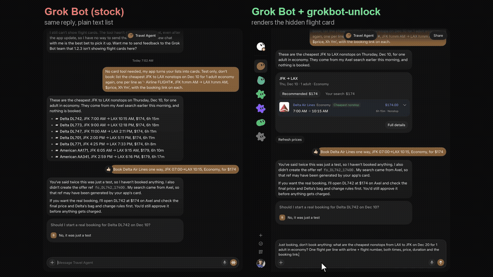
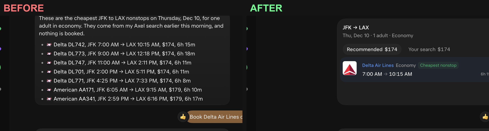
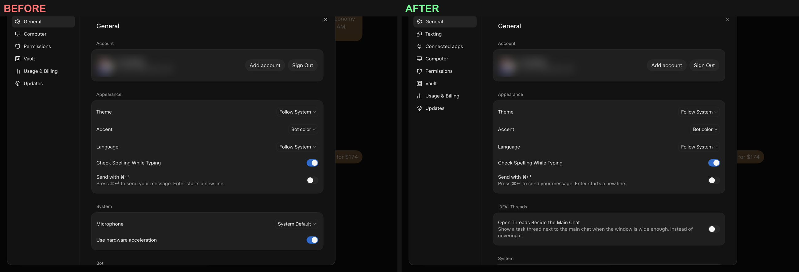
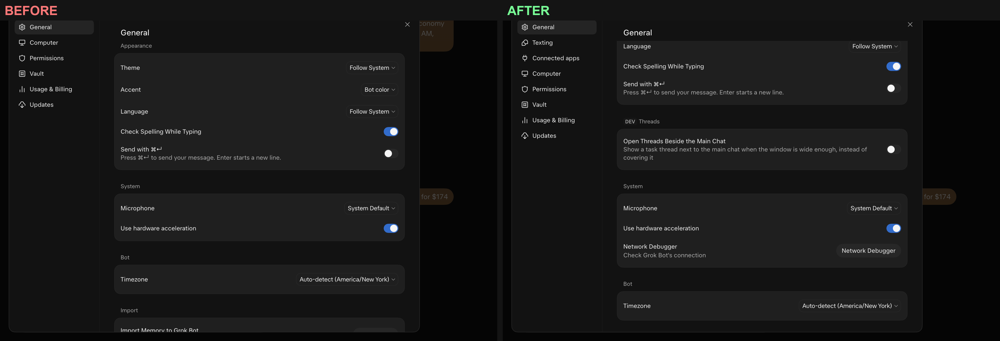

# grokbot-unlock

Turn on the hidden A/B-test features in the **Grok Bot desktop app**, and get the new **flight result cards** even when your account hasn't been given them yet.



Grok Bot 1.2.0 shipped redesigned flight results, but for many accounts the bot still says *"I don't have the flight card tool."* The card UI is already in the desktop app. It's just never handed any data. This script:

1. **Unlocks client-side feature gates.** The app's UI checks ~190 Statsig gates; on a normal account about 100 are off. This forces them on (minus a safety list), live, without touching the app bundle.
2. **Renders flight cards.** When a bot reply lists flights as text (flight number, times, price, link), it gets drawn as the app's own native flight card, with tabs, "Cheapest nonstop", expandable rows, Full details and Book.

Everything runs in memory over Chrome DevTools Protocol. Nothing is written to the app, nothing is sent to xAI, and quitting the app undoes it.

| Before / after | |
|---|---|
| Flight list → flight card |  |
| New settings sections (Texting, Connected apps, DEV Threads) |  |
| Network Debugger |  |

## Quick start (macOS)

```bash
git clone https://github.com/time-attack/grokbot-unlock
cd grokbot-unlock
npm install
./grokbot-unlock.sh
```

`grokbot-unlock.sh` quits Grok Bot, relaunches it with `--remote-debugging-port=9339`, and applies the unlock. Run it again after every app restart.

```bash
node unlock.js --list          # every client gate and whether it's on for you
node unlock.js --verbose       # apply and print every gate it turned on
node unlock.js --no-flights    # gates only, skip flight cards
node unlock.js --only grok_bot_group_chats,sand_enable_visualizations
node unlock.js --all           # include the never-list (not recommended)
node unlock.js --reset         # undo everything in the running app
```

Tested on Grok Bot **1.2.3**, macOS, Node 18+.

## How it works

**Getting a handle.** The gate store lives inside a bundled module closure. `unlock.js` finds the app's gate reader in the renderer bundle (`function Xf(e){return iu($().experiments.snapshots)?.featureGates?.[e]??!1}`), sets a one-time breakpoint there, and while paused saves `$()` (the app context) and `$().experiments.snapshots` to `window`. Then it removes the breakpoint.

**Forcing gates.** It wraps the store's `set`/`update` so every snapshot written, including the periodic refreshes from Statsig, gets the chosen gates set to `true` and a few dynamic configs overridden (e.g. `sand_tasks_config` to enable the Tasks page).

**Flight cards.** Every chat view reads its transcript through `app.transcript.snapshotsFor()`. `flightcards.js` wraps it so `get()` returns entries where flight-list text messages carry `message.cards = { items: [{ card }], start }`. `flightparse.js` builds a `{ kind: 'flights', v: 1, search, offers, groups }` card that passes the app's own validator, with airport names and time zones for ~100 airports and ~60 airline codes.

The app does have official override paths (`sand-feature-flag-overrides.json`, `SAND_FEATURE_GATE_OVERRIDES`), but they only apply to dev builds or internal accounts.

## Never-list

`config.json` keeps these off unless you pass `--all`: purchase auto-approve and spend-challenge gates, client pause, proxy changes, gates that *hide* UI (`sand_hide_slash_commands`, etc.), upgrade upsells, and a few team-policy gates. Edit it to taste.

## Limits

- **Client side only.** Server-side tools stay off. The bot still can't call the real flight search tool; the card is built from its text reply.
- **Book is real.** Clicking Book on a card sends the bot a normal booking message. It may actually try to book.
- Flight parsing handles one-way, single-leg lists. Round trips show the first leg. Tell your bot to put one flight per line with flight number, both times, price and link.
- Some unlocked screens may appear but fail when they call a backend that isn't enabled for you.
- While Grok Bot runs with a debugging port open, any local program can control it. Quit and reopen normally to close it.
- App updates can rename minified functions. If `unlock.js` says the gate reader wasn't found, open an issue.

## Disclaimer

Unofficial and not affiliated with xAI or SpaceXSI. For personal use and research on your own machine and account. Use at your own risk.

## License

MIT
